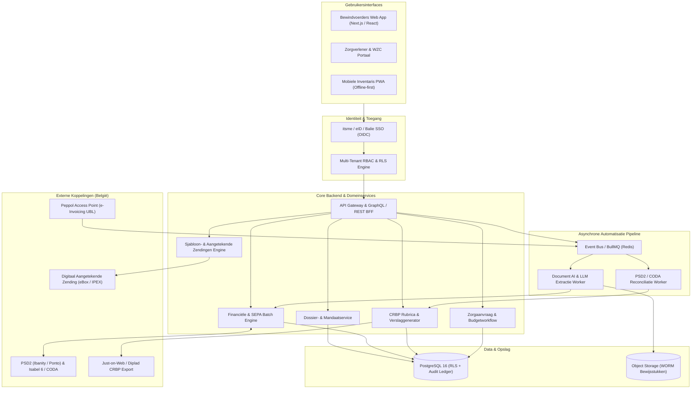
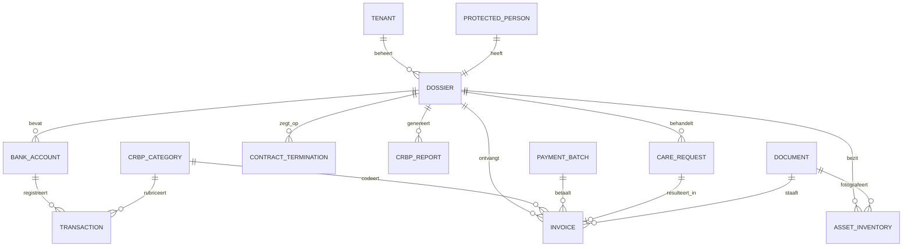
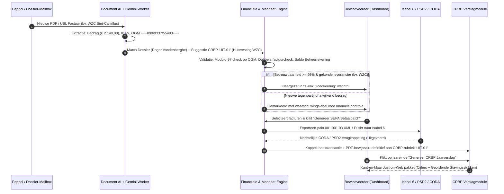

# Technisch Ontwerp: SaaS-Platform voor Professionele Bewindvoering ("Curatela")

Dit document vormt de volledige technische architectuur en specificatie voor een SaaS-platform gericht op **professionele bewindvoerders** (advocaten en gespecialiseerde kantoren) die de goederen en de persoon beheren van alleenstaande ouderen en wilsonbekwamen onder het Belgisch bewindvoeringsrecht (Boek 1, Titel XI Burgerlijk Wetboek — Rechterlijke Bescherming).

> [!IMPORTANT]
> **Juridische kernscheiding in de architectuur:** Het systeem dwingt technisch het onderscheid af tussen **bescherming van de goederen** (vermogensbeheer, factuurbetalingen, buitengewone machtigingen art. 499/7 BW) en **bescherming van de persoon** (verblijfplaats, organisatie van zorgcontracten via derden), met volledige traceerbaarheid richting het **Centraal Register van de Bescherming van de Personen (CRBP)**.

---

## 1. Systeemarchitectuur & Tech Stack Aanbeveling

### 1.1 Architectuurpatroon
Voor een juridisch-financieel platform met hoge eisen rond auditability, multi-tenancy (kantoorisolatie) en asynchrone documentverwerking kiezen we voor een **Modulaire Monoliet met Asynchrone Event-Workers**:
- Een strikt getypeerde kernapplicatie verwerkt synchrone gebruikersacties, autorisatie en transactie-integriteit.
- Asynchrone workers (via een duurzame job-queue) verwerken inkomende PDF-facturen, Peppol UBL-berichten, OCR-extractie en dagelijkse PSD2/CODA-bankreconciliaties.



### 1.2 Aanbevolen Tech Stack (Belgisch Ecosysteem)

| Laag | Technologie | Motivatie in Bewindvoeringscontext |
| :--- | :--- | :--- |
| **Frontend & Mobiel** | **Next.js (TypeScript)** + React Query + PWA | Eén codebase voor het kantoor-dashboard, het beveiligde WZC-zorgportaal en de offline-first mobiele plaatsbeschrijvingsapp. |
| **Backend & API** | **Node.js (NestJS)** of **.NET 8 (C#)** | Sterke typering, modulaire domeinscheiding en uitstekende ondersteuning voor XML/XSD-validatie (`pain.001.001.03`, `camt.053`, UBL 2.1). |
| **Database** | **PostgreSQL 16** met **Row-Level Security (RLS)** | Afgedwongen isolatie per advocatenkantoor (`tenant_id`) en per dossier (`dossier_id`), plus `numeric(14,2)` precisie voor boekhouding. |
| **Document AI & OCR** | **Google Cloud Document AI (Invoice Parser)** + **Gemini 2.5 Pro** | Extractie van Belgische gestructureerde mededelingen (`+++xxx/xxxx/xxxxx+++`), IBAN, vervaldata én contextuele CRBP-rubricering. |
| **Bankkoppelingen** | **Ibanity (Isabel Group) / Ponto** + **CODA / Isabel 6** | Belgische standaard voor PSD2 multibanking, CODA-rekeningafschriften en SEPA XML-betaalbatches voor derden- en beheerrekeningen. |
| **E-Facturatie & Post** | **Peppol Access Point** + **eBox Enterprise / bpost Registered** | Ontvangst van gestructureerde facturen van ziekenhuizen/rusthuizen en rechtsgeldige verzending van opzegbrieven en kennisgevingen. |
| **Authenticatie** | **itsme® / Belgische eID (via OIDC)** + **DPA/RegSol SSO** | Sterke 2FA-authenticatie voor zowel advocaten als geautoriseerd zorgpersoneel in woonzorgcentra. |

---

## 2. Database Schema (ERD & PostgreSQL DDL)

### 2.1 Entity-Relationship Diagram (ERD)



### 2.2 PostgreSQL Schema (Kernentiteiten)

```sql
-- 1. Dossier & Rechterlijke Mandaatgegevens
CREATE TYPE mandate_scope AS ENUM ('GOODS_ONLY', 'PERSON_ONLY', 'GOODS_AND_PERSON');
CREATE TYPE representation_mode AS ENUM ('ASSISTANCE', 'REPRESENTATION');
CREATE TYPE living_situation AS ENUM ('HOME_INDEPENDENT', 'HOME_WITH_CARE', 'NURSING_HOME', 'PSYCHIATRIC_CARE');

CREATE TABLE dossiers (
    id UUID PRIMARY KEY DEFAULT gen_random_uuid(),
    tenant_id UUID NOT NULL, -- Advocatenkantoor (RLS sleutel)
    crbp_reference VARCHAR(64) UNIQUE NOT NULL, -- Referentie in Centraal Register
    peace_court_canton VARCHAR(120) NOT NULL, -- Bv. "Vredegerecht 2de Kanton Antwerpen"
    appointment_date DATE NOT NULL,
    annual_report_due_month SMALLINT NOT NULL CHECK (annual_report_due_month BETWEEN 1 AND 12),
    scope mandate_scope NOT NULL DEFAULT 'GOODS_AND_PERSON',
    mode representation_mode NOT NULL DEFAULT 'REPRESENTATION',
    living_status living_situation NOT NULL,
    weekly_allowance_cents BIGINT NOT NULL DEFAULT 7500, -- Bv. € 75,00/week leefgeld
    min_management_buffer_cents BIGINT NOT NULL DEFAULT 150000, -- Min. buffer op beheerrekening
    status VARCHAR(32) NOT NULL DEFAULT 'ACTIVE',
    created_at TIMESTAMPTZ NOT NULL DEFAULT now()
);

-- 2. Beschermde Persoon (PII & Gevoelige Data)
CREATE TABLE protected_persons (
    id UUID PRIMARY KEY DEFAULT gen_random_uuid(),
    dossier_id UUID NOT NULL UNIQUE REFERENCES dossiers(id) ON DELETE RESTRICT,
    national_register_nr_encrypted BYTEA NOT NULL, -- Rijksregisternummer (KMS encrypted)
    first_name VARCHAR(100) NOT NULL,
    last_name VARCHAR(100) NOT NULL,
    birth_date DATE NOT NULL,
    residence_name VARCHAR(200), -- Bv. "WZC Sint-Camillus"
    residence_address TEXT NOT NULL,
    mutuality_code VARCHAR(16), -- Ziekenfonds code
    katz_scale VARCHAR(8) -- Zorgzwaarte-indicatie (O, A, B, C, Cd)
);

-- 3. Bankrekeningen (Beheerrekening, Leefgeldrekening, Spaarrekening)
CREATE TYPE account_role AS ENUM ('MANAGEMENT', 'ALLOWANCE', 'SAVINGS', 'BLOCKED_ESTATE');

CREATE TABLE bank_accounts (
    id UUID PRIMARY KEY DEFAULT gen_random_uuid(),
    dossier_id UUID NOT NULL REFERENCES dossiers(id),
    iban VARCHAR(34) NOT NULL UNIQUE,
    bic VARCHAR(11) NOT NULL,
    bank_name VARCHAR(80) NOT NULL,
    role account_role NOT NULL,
    current_balance_cents BIGINT NOT NULL DEFAULT 0,
    psd2_consent_expires_at TIMESTAMPTZ,
    last_synced_at TIMESTAMPTZ
);

-- 4. Officiële CRBP-Rubrieken (Wettelijk model Vredegerecht)
CREATE TABLE crbp_categories (
    code VARCHAR(16) PRIMARY KEY, -- Bv. 'INK-01', 'UIT-02', 'UIT-04'
    direction VARCHAR(10) NOT NULL CHECK (direction IN ('INCOME', 'EXPENSE', 'ASSET', 'LIABILITY')),
    official_label_nl VARCHAR(200) NOT NULL, -- Bv. "Huisvestings- en verblijfskosten (WZC / Huur)"
    requires_judicial_auth BOOLEAN NOT NULL DEFAULT FALSE -- Art. 499/7 BW machtiging vereist?
);

-- 5. Inkomende Facturen (OCR & Peppol)
CREATE TYPE invoice_status AS ENUM (
    'OCR_REVIEW_NEEDED', 'READY_FOR_BATCH', 'QUEUED_IN_SEPA_BATCH', 'PAID_RECONCILED', 'REJECTED'
);

CREATE TABLE invoices (
    id UUID PRIMARY KEY DEFAULT gen_random_uuid(),
    dossier_id UUID NOT NULL REFERENCES dossiers(id),
    document_id UUID NOT NULL, -- Verwijzing naar WORM S3 PDF/UBL
    supplier_name VARCHAR(200) NOT NULL,
    supplier_iban VARCHAR(34) NOT NULL,
    amount_cents BIGINT NOT NULL CHECK (amount_cents > 0),
    currency CHAR(3) NOT NULL DEFAULT 'EUR',
    structured_reference VARCHAR(25), -- Belgische OGM: +++123/4567/89012+++
    unstructured_remittance VARCHAR(140),
    issue_date DATE NOT NULL,
    due_date DATE NOT NULL,
    crbp_category_code VARCHAR(16) REFERENCES crbp_categories(code),
    ocr_confidence NUMERIC(4,3) NOT NULL DEFAULT 1.000,
    anomaly_flags JSONB NOT NULL DEFAULT '[]'::jsonb, -- Bv. ["DUPLICATE_OGM", "UNKNOWN_IBAN"]
    status invoice_status NOT NULL DEFAULT 'OCR_REVIEW_NEEDED',
    payment_batch_id UUID,
    approved_by_user_id UUID,
    approved_at TIMESTAMPTZ,
    created_at TIMESTAMPTZ NOT NULL DEFAULT now()
);

-- 6. Banktransacties & CRBP-Koppeling
CREATE TABLE transactions (
    id UUID PRIMARY KEY DEFAULT gen_random_uuid(),
    bank_account_id UUID NOT NULL REFERENCES bank_accounts(id),
    dossier_id UUID NOT NULL REFERENCES dossiers(id),
    external_tx_id VARCHAR(128) UNIQUE NOT NULL, -- CODA / PSD2 transactie-ID
    booking_date DATE NOT NULL,
    amount_cents BIGINT NOT NULL, -- Positief = inkomst, Negatief = uitgave
    counterparty_name VARCHAR(200),
    counterparty_iban VARCHAR(34),
    remittance_info TEXT,
    crbp_category_code VARCHAR(16) REFERENCES crbp_categories(code),
    linked_invoice_id UUID REFERENCES invoices(id),
    classification_source VARCHAR(20) NOT NULL DEFAULT 'RULE_ENGINE', -- 'RULE_ENGINE', 'AI', 'MANUAL'
    included_in_report_id UUID
);

-- 7. Zorgverlener & WZC Aanvragen (Kleine & Buitengewone Uitgaven)
CREATE TYPE care_request_status AS ENUM ('PENDING', 'APPROVED', 'REJECTED', 'PAID');

CREATE TABLE care_requests (
    id UUID PRIMARY KEY DEFAULT gen_random_uuid(),
    dossier_id UUID NOT NULL REFERENCES dossiers(id),
    requester_org VARCHAR(200) NOT NULL, -- Bv. "WZC Sint-Camillus - Afdeling Zonnebloem"
    requester_name VARCHAR(120) NOT NULL,
    title VARCHAR(200) NOT NULL, -- Bv. "Orthopedische winterschoenen"
    justification TEXT NOT NULL,
    estimated_amount_cents BIGINT NOT NULL,
    crbp_category_code VARCHAR(16) NOT NULL REFERENCES crbp_categories(code),
    urgency VARCHAR(16) NOT NULL DEFAULT 'NORMAL',
    status care_request_status NOT NULL DEFAULT 'PENDING',
    decision_note TEXT,
    decided_by_user_id UUID,
    decided_at TIMESTAMPTZ,
    created_at TIMESTAMPTZ NOT NULL DEFAULT now()
);
```

---

## 3. API & Automatisatie Pipelines

### 3.1 End-to-End Factuur-naar-Betaalbatch & CRBP-Verslag Pipeline

Onderstaande sequence toont hoe een inkomende factuur (via Peppol, de unieke dossier-mailbox of postscan) volledig geautomatiseerd doorloopt tot in het jaarverslag voor de vrederechter:



### 3.2 Kernregels van de Automatisatie-Engine
1. **Modulo-97 OGM Validatie & Auto-Repair:** Elke gescande Belgische gestructureerde mededeling (`+++ABC/DEFG/HIJKK+++`) wordt wiskundig gecontroleerd (`int(ABCDEFGHIJ) % 97 == KK`, of `97` indien rest `0`). Bij een OCR-leesfout (bv. `8` vs `B`) herstelt de parser dit of dwingt manuele verificatie af.
2. **Negatief-Saldo & Leefgeld-Bewaker:** Voordat een periodieke leefgeldopdracht of SEPA-batch vertrekt, controleert de engine:
   $$\text{Vrij Saldo Beheerrekening} - \sum \text{Batch} - \text{Gereserveerde Vaste Kosten (WZC)} \ge \text{Minimumbuffer}$$
   Bij dreigend tekort blokkeert het systeem niet-kritieke facturen en stelt het automatisch een aflossingsplan of verschuiving vanaf de spaarrekening voor.
3. **Wettelijke Mandaatbewaking (Art. 499/7 BW):** Zodra een transactie of contractactie betrekking heeft op een rechtshandeling waarvoor een bijzondere machtiging van de vrederechter nodig is (zoals verkoop van onroerend goed, dading, of opvraging van geblokkeerde spaargelden), vraagt de workflow verplicht om het gekoppelde **Beschikkingsnummer van de Vrederechter** voordat uitvoering mogelijk is.

### 3.3 Overzicht Kern-API Endpoints

| Methode & Pad | Doel | Rol / Scope |
| :--- | :--- | :--- |
| `POST /api/v1/webhooks/peppol-inbound` | Ontvangt Peppol UBL / PDF facturen en start de OCR-pipeline. | System Webhook |
| `GET /api/v1/dossiers/:id/financial-overview` | Haalt saldi (beheer/leefgeld/spaar), cashflow en budgetwaarschuwingen op. | Bewindvoerder |
| `POST /api/v1/payment-batches/sepa-xml` | Valideert geselecteerde facturen en genereert een `pain.001.001.03` XML-bestand. | Bewindvoerder (2FA) |
| `POST /api/v1/dossiers/:id/crbp-reports/generate` | Compileert alle gecategoriseerde transacties en PDF-bijlagen tot een CRBP-verslag. | Bewindvoerder |
| `POST /api/v1/care-portal/requests` | Zorgverlener dient een gestructureerde uitgave-aanvraag in met offerte/foto. | Zorgverlener (WZC) |
| `PATCH /api/v1/care-portal/requests/:reqId/decision` | Keurt een zorgaanvraag goed (reserveert budget) of wijst deze gemotiveerd af. | Bewindvoerder |
| `POST /api/v1/dossiers/:id/notifications/dispatch` | Genereert en verstuurt officiële kennisgevings- of opzegbrieven naar instanties. | Bewindvoerder |

---

## 4. UI/UX Draadmodel & Frontend Componentenstructuur

De applicatie biedt twee strikt gescheiden ervaringen binnen één ontwerpstelsel:
1. **Het Bewindvoerderskantoor (Hoofdpaneel):** Geoptimaliseerd voor snelheid, bulkverwerking over tientallen dossiers heen, en directe dossier-drilldown.
2. **Het Zorgverlener- & WZC-Portaal:** Een beknopt, taakgericht portaal waar hoofdverpleegkundigen of maatschappelijk werkers van een rusthuis uitsluitend voor de aan hen toegewezen bewoners leefgeldstatus en uitgave-aanvragen kunnen beheren (zonder inzage in het volledige vermogen of bankrekeningen).

```
AppShell
├── TopBar
│   ├── DossierSelector (Snelzoeken op naam, CRBP-nummer of Vredegerecht)
│   ├── RolModusSchakelaar (Bewindvoerder Weergave ↔ WZC Zorgportaal Preview)
│   └── MeldingenBell (Saldo-alarmen, Vervaldata CRBP-verslagen)
├── SidebarNavigatie
│   ├── 1. Financieel & OCR Factuurhub
│   ├── 2. CRBP Jaarverslaglegging (Vredegerecht)
│   ├── 3. Zorgportaal & Briefautomatisatie
│   └── 4. Woning, Inventaris & Opzeggingen
└── ModuleWerkruimte
    ├── FinancieelDashboard
    │   ├── MultibankingKaarten (Beheerrekening, Leefgeldrekening, Spaarrekening + Saldo-check)
    │   ├── OCRFactuurWachtrij (Confidence-score, OGM-validatie, CRBP-tag, Selectie voor SEPA)
    │   └── SEPABatchModal (Live pain.001 XML preview & download)
    ├── CRBPVerslagModule
    │   ├── RubriekenBalans (Inkomsten vs. Uitgaven volgens wettelijke CRBP-codes)
    │   ├── EreloonCalculator (Wettelijk forfait 3% op inkomsten + buitengewone prestaties art. 497/5 BW)
    │   └── OneClickVerslagModal (Gegenereerd verslag voor Just-on-Web incl. stavingsstukken)
    ├── ZorgEnStakeholderModule
    │   ├── ZorgAanvragenLijst (1-klik Goedkeuren & Budget reserveren / Afwijzen)
    │   ├── NieuweZorgAanvraagFormulier (Voor WZC-personeel)
    │   └── KennisgevingsBrievenGenerator (FOD Financiën, Mutualiteit, Banken, Nutsbedrijven)
    └── WoningEnContractenModule
        ├── PlaatsbeschrijvingInventaris (Goederen, foto-status, machtiging vrederechter art. 499/7 BW)
        └── ContractOpzegHub (Automatische opzeg bij verhuis naar WZC + besparingsteller)
```

---

## 5. Veiligheid, Aansprakelijkheid & Privacy (GDPR / Balie)

Omdat een bewindvoerder werkt met **uiterst gevoelige persoonsgegevens** van kwetsbare burgers (financiële gegevens, rijksregisternummers en onrechtstreeks gezondheidsgegevens onder Art. 9 AVG zoals Katz-schalen en ziekenhuisfacturen), gelden de volgende beveiligingsmaatregelen:

1. **Strikte Scheiding van Gezondheids- en Vermogensdata (Minimale Gegevensverwerking):**
   - Een woonzorgcentrum of thuiszorgdienst die inlogt op het Zorgportaal krijgt via een scopebeperkt token enkel te zien of een aangevraagde uitgave binnen het beschikbare comfortbudget past (**Groen / Oranje / Rood** indicator), nooit het totale spaarsaldo of de waarde van het onroerend goed van de beschermde persoon.
2. **Envelope Encryption per Kantoor (KMS) & WORM-opslag:**
   - Alle rijksregisternummers, IBANs en medische bijlagen worden op kolomniveau versleuteld met een kantoor-specifieke Data Encryption Key (DEK) beheerd via een Hardware Security Module (HSM / Cloud KMS).
   - Alle stavingsstukken (facturen, beschikkingen van de vrederechter, plaatsbeschrijvingen) worden opgeslagen in **Write-Once-Read-Many (WORM)** object storage gedurende de wettelijke bewaartermijn na het einde van het bewind (Art. 499/19 BW).
3. **Onweerlegbare Audit Trail (Cryptografische Hash-Chain):**
   - Elke goedkeuring van een factuur, wijziging van een leefgeldbedrag, aanpassing van een CRBP-rubriek of export van een SEPA-batch wordt weggeschreven in een `append-only` audit-tabel met het eID/itsme-subjektnr van de advocaat of kantoor-medewerker.
4. **Four-Eyes & Delegeringsbeleid binnen het Advocatenkantoor:**
   - Administratieve medewerkers van de bewindvoerder kunnen facturen voorbereiden, inscannen en klaarzetten in de SEPA-wachtrij, maar het daadwerkelijk vrijgeven van een betaalbatch of het indienen van het CRBP-jaarverslag vereist de digitale handtekening / 2FA van de aangestelde advocaat-bewindvoerder.
